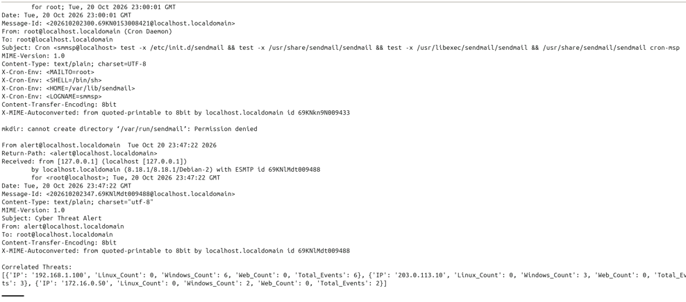
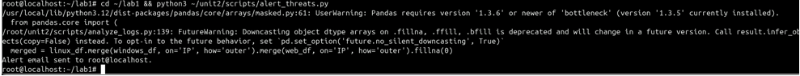

# Security Log Collection and Analysis Automation

In this lab, I collected and analyzed activity logs from Linux, Windows, and a web server. I used Linux commands and regular expressions to review failed logins, PowerShell to export Windows Security events, and Python to collect, filter, and analyze the logs. I also used Pandas and Matplotlib to summarize activity, create a graph, and generate reports, then verified that the alert script sent an email. These exercises show how automation can help security teams review activity across different systems and investigate suspicious events.

## Manual Linux log review

I used Linux commands to find failed password attempts, extract and count their source IP addresses, and identify IPs with more than five attempts. The sample contained 15 failed attempts. The most frequent source was `192.168.1.100`, with 9 attempts.

## Regex username extraction

I tested a regular expression against a failed-login message. The pattern handles both ordinary usernames and messages that include `invalid user`, helping extract the attempted username for review.

## Windows Security log export

I ran the PowerShell export script on the Windows VM and verified that it created the Security events JSON file in `C:\Logs`. This file was later used for analysis on the Ubuntu collection VM.

## Failed SSH login event

I attempted an SSH login with an incorrect password, then queried the Windows Security log for failed logons. The output showed the attempt as Event ID 4625.

## PowerShell failed-logon metric

I used PowerShell to count Windows Security events for failed logons (Event ID 4625) and display the event times. In my run, the script found one failed-logon event.

## Windows Event Viewer audit failure

I used Event Viewer to locate the Windows Security audit failure created by my incorrect SSH login. The event was recorded as Event ID 4625.

## GUI review of failed login events

I used the PowerShell graphical event viewer to review Security log entries. It displayed the failed SSH login as Event ID 4625, matching the event I found in Event Viewer.

## Collecting logs from the lab systems

I ran `fetch_logs.py` on the Ubuntu collection VM and checked that it saved the Linux authentication log, Windows Security events JSON, and Apache access log in `/root/lab1/logs`.

## Enhancing log collection

I updated the collection script to read connection settings from a separate configuration file, record errors, and save recent authentication and web log entries for review. I kept credentials out of this public repository.

## Analyzing the collected logs

I ran `analyze_logs.py` against the collected lab logs to check for repeated failed logins and suspicious web requests. In this run, the script did not flag threats in the current logs because the activity did not meet its configured thresholds.

## Analyzing the sample Windows events

I reran the analysis using the provided sample Windows log. It showed repeated failed logons from three IP addresses: `192.168.1.100` (6 events), `203.0.113.10` (3), and `172.16.0.50` (2). The Linux and web logs had no matching activity from those IPs in this run.

## Visualizing web status codes

I used Pandas and Matplotlib to count the HTTP status codes in the Apache access log and display the counts as a bar graph.

## Enhanced Pandas analysis

I added Pandas-based analysis that counted successful and error web responses and summarized activity across the log sources. This run showed 3 successful responses and no 401/404 errors, so the success-to-error ratio was undefined. The script also generated CSV reports.

## Verifying alert delivery

I checked the Ubuntu VM’s local mailbox and confirmed that the threat alert email was received.

## Enhanced email alert

I enhanced the alert script to create a formatted email summary of correlated threats and log email-delivery errors. The script ran successfully and reported that it sent the alert.

## Challenges I encountered

During the lab, I worked through several issues while setting up and running the scripts. The PowerShell export script needed a small encoding adjustment, and I corrected the Windows log export after finding a stray Markdown code fence in the script. I also had to update the lab machine IP addresses and resolve file path and permissions issues while collecting logs.

The log collection script initially saved an empty filtered web log because there were no recent web requests. After generating a new request and running the script again, it captured the entry. I also found that the Windows JSON export included a UTF-8 byte order mark, so I updated the analysis script to read the file with `utf-8-sig`.

These troubleshooting steps helped me verify each stage: exporting, transferring, filtering, analyzing, and reporting the logs.

## What I learned

I learned how to collect security logs from Linux, Windows, and a web server and use them together during an investigation. I practiced searching Linux logs with command-line tools, using PowerShell to review Windows Event ID 4625, and writing Python code to collect and filter recent log entries.

I also learned how Pandas can group and compare events by IP address, while Matplotlib can turn web status counts into a graph. The lab showed me that a script’s results depend on the data and thresholds: an empty result does not always mean the script failed; the activity might not meet the detection criteria.

## What I could improve

I could improve the project by storing credentials in environment variables or a secrets manager instead of a configuration file, and by ensuring no passwords or sensitive logs are included in a public repository. I could also make the scripts more reliable by validating configuration values, handling connection and file errors separately, and reporting clear success or failure messages.

For the analysis, I could add date-range options, make detection thresholds configurable, and test the scripts with both normal activity and known suspicious sample data. I could also improve the reports by recording when each collection ran and adding more context to each alert.
