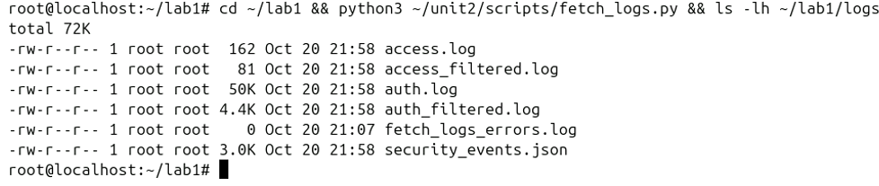
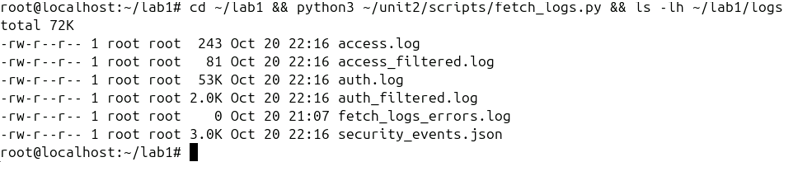
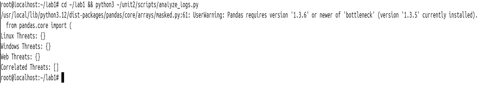
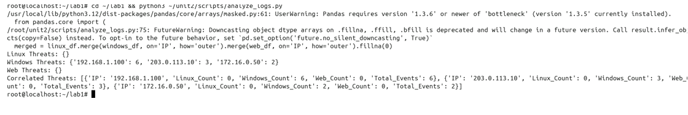
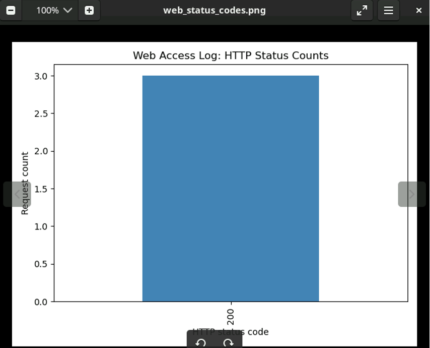
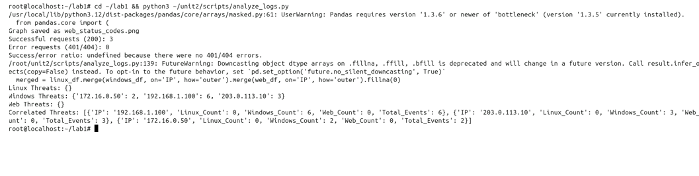

# Security Log Collection and Analysis Automation

This lab explored how security teams collect and review computer activity records called logs.

## Manual Linux log review

I used Linux commands to find failed password attempts, extract and count their source IP addresses, and identify IPs with more than five attempts. The sample contained 15 failed attempts. The most frequent source was `192.168.1.100`, with 9 attempts.

## Regex username extraction

I tested a regular expression against a failed-login message. The pattern handles both ordinary usernames and messages that include `invalid user`, helping extract the attempted username for review.

## Windows Security log export

I ran the PowerShell export script on the Windows VM and verified that it created the Security events JSON file in `C:\Logs`. This file was later used for analysis on the Ubuntu collection VM.

## Failed SSH login event

I attempted an SSH login with an incorrect password, then queried the Windows Security log for failed logons. The output showed the attempt as Event ID 4625.

## PowerShell failed-logon metric

I used PowerShell to count Windows Security events for failed logons (Event ID 4625) and display the event times. In my run, the script found one failed-logon event.

## Windows Event Viewer audit failure

I used Event Viewer to locate the Windows Security audit failure created by my incorrect SSH login. The event was recorded as Event ID 4625.

## GUI review of failed login events

I used the PowerShell graphical event viewer to review Security log entries. It displayed the failed SSH login as Event ID 4625, matching the event I found in Event Viewer.

## Collecting logs from the lab systems

I ran `fetch_logs.py` on the Ubuntu collection VM and checked that it saved the Linux authentication log, Windows Security events JSON, and Apache access log in `/root/lab1/logs`.

## Enhancing log collection

I updated the collection script to read connection settings from a separate configuration file, record errors, and save recent authentication and web log entries for review. I kept credentials out of this public repository.

## Analyzing the collected logs

I ran `analyze_logs.py` against the collected lab logs to check for repeated failed logins and suspicious web requests. In this run, the script did not flag threats in the current logs because the activity did not meet its configured thresholds.

## Analyzing the sample Windows events

I reran the analysis using the provided sample Windows log. It showed repeated failed logons from three IP addresses: `192.168.1.100` (6 events), `203.0.113.10` (3), and `172.16.0.50` (2). The Linux and web logs had no matching activity from those IPs in this run.

## Visualizing web status codes

I used Pandas and Matplotlib to count the HTTP status codes in the Apache access log and display the counts as a bar graph.

## Enhanced Pandas analysis

I added Pandas-based analysis that counted successful and error web responses and summarized activity across the log sources. This run showed 3 successful responses and no 401/404 errors, so the success-to-error ratio was undefined. The script also generated CSV reports.

