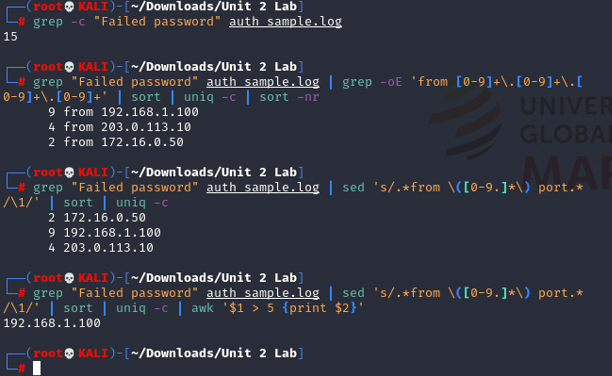
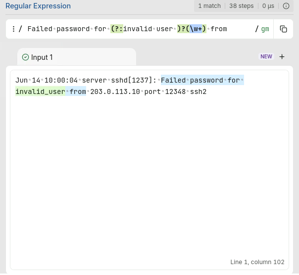
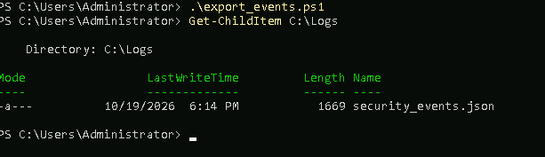
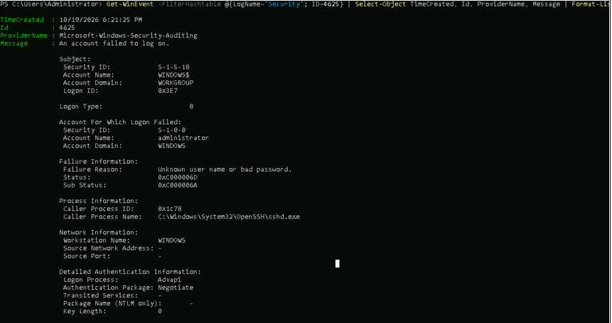
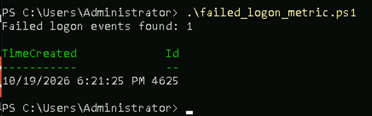
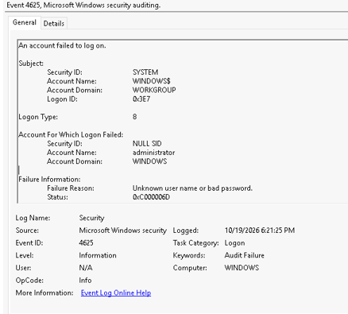
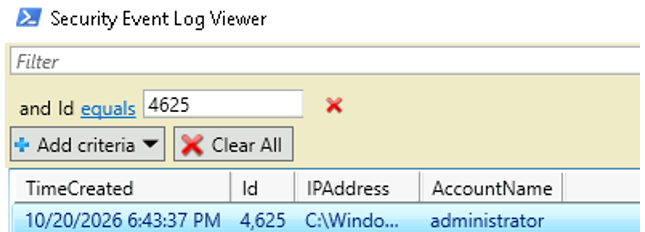

# Security Log Collection and Analysis Automation

This lab explored how security teams collect and review computer activity records called logs.

## Manual Linux log review

I used Linux commands to find failed password attempts, extract and count their source IP addresses, and identify IPs with more than five attempts. The sample contained 15 failed attempts. The most frequent source was `192.168.1.100`, with 9 attempts.

## Regex username extraction

I tested a regular expression against a failed-login message. The pattern handles both ordinary usernames and messages that include `invalid user`, helping extract the attempted username for review.

## Windows Security log export

I ran the PowerShell export script on the Windows VM and verified that it created the Security events JSON file in `C:\Logs`. This file was later used for analysis on the Ubuntu collection VM.

## Failed SSH login event

I attempted an SSH login with an incorrect password, then queried the Windows Security log for failed logons. The output showed the attempt as Event ID 4625.

## PowerShell failed-logon metric

I used PowerShell to count Windows Security events for failed logons (Event ID 4625) and display the event times. In my run, the script found one failed-logon event.

## Windows Event Viewer audit failure

I used Event Viewer to locate the Windows Security audit failure created by my incorrect SSH login. The event was recorded as Event ID 4625.

## GUI review of failed login events

I used the PowerShell graphical event viewer to review Security log entries. It displayed the failed SSH login as Event ID 4625, matching the event I found in Event Viewer.

